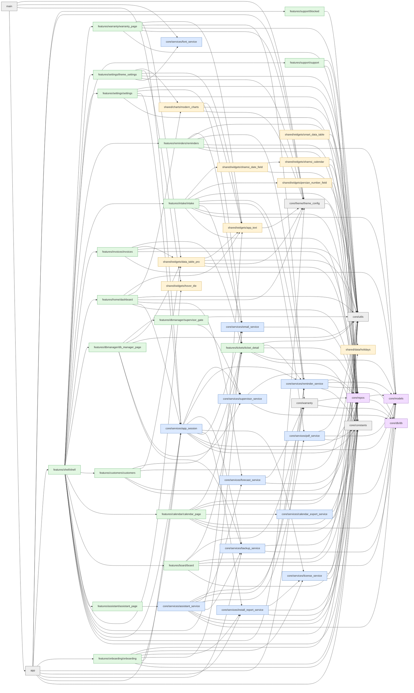

# نقشه گراف معماری برنامه (Graphify)

**آخرین به‌روزرسانی:** 2026-11-25T20:31:41
**فایل‌های Dart:** 48 — **خطوط کد:** 10592 — **لبه‌های وابستگی داخلی:** 174

## چطور استفاده کنم؟
قبل از هر اصلاح، فایل هدف را در گراف پیدا کن؛ مسیر وابستگی‌هایش نشان می‌دهد چه چیزهایی تحت‌تأثیر قرار می‌گیرند. بعد از اصلاح، دوباره graphify اجرا کن (اسکیل واچر).

## ماژول‌ها

| ماژول | فایل‌ها | خطوط |
|---|---|---|
| core/services | 12 | 1878 |
| shared/widgets | 7 | 1458 |
| features/settings | 2 | 731 |
| shared/charts | 1 | 652 |
| features/dbmanager | 2 | 573 |
| core/theme | 1 | 465 |
| features/shell | 1 | 458 |
| features/intake | 1 | 385 |
| features/onboarding | 1 | 366 |
| core/models.dart | 1 | 353 |
| core/repos.dart | 1 | 337 |
| features/calendar | 1 | 325 |
| features/tickets | 1 | 295 |
| features/home | 1 | 280 |
| features/customers | 1 | 264 |
| features/warranty | 1 | 240 |
| core/db | 1 | 206 |
| root | 2 | 196 |
| features/board | 1 | 181 |
| features/assistant | 1 | 173 |
| features/support | 2 | 157 |
| features/reminders | 1 | 152 |
| features/invoices | 1 | 145 |
| core/warranty.dart | 1 | 125 |
| core/utils.dart | 1 | 86 |
| core/constants.dart | 1 | 58 |
| shared/data | 1 | 53 |

## گراف وابستگی‌ها

## فایل‌های بدون وابستگی ورودی (ورودی آزاد)

- lib/main.dart
- lib/shared/widgets/smart_data_table.dart