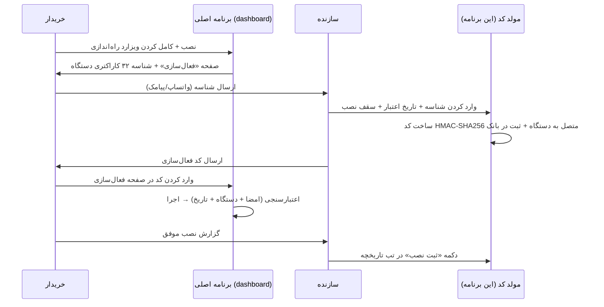

# مولد کد فعال‌سازی J.S.H — برنامه جانبی سازنده

این برنامه **فقط روی رایانه سازنده** اجرا می‌شود و کد فعال‌سازی برنامه اصلی «داشبورد تعمیرات و خدمات» را می‌سازد (بند ۲ درخواست صاحب پروژه). خریدار هرگز این برنامه را نمی‌گیرد.

> **مستندات کامل در پوشه [`docs/`](docs/):** تمام دستورات، نقشه معماری، فرمت بایت‌به‌بایت کد، بانک تاریخچه، راهنمای تغییرات و عیب‌یابی.

## در یک نگاه

| تب | عملکرد |
|---|---|
| **تولید کد** | ورود شناسه ۳۲ کاراکتری دستگاه خریدار + نام خریدار + تاریخ اعتبار شمسی + سقف نصب مجدد → کد `JSH-XXXXXX-…` |
| **تاریخچه کدها** | همه کدهای صادرشده در بانک محلی: کد، خریدار، انقضا، سقف نصب، نصب گزارش‌شده + دکمه «ثبت نصب» + خروجی CSV |
| **راهنما** | مراحل گام‌به‌گام فعال‌سازی خریدار + نکات امنیتی |

دکمه‌های میان‌بر اعتبار: **۱ ماه / ۳ ماه / ۶ ماه / ۱ سال / ۲ سال** — یا تاریخ دلخواه شمسی.

## جریان کامل فعال‌سازی خریدار



## شروع سریع

**راه ۱ — فایل آماده (پیشنهادی):** آخرین نسخه را از [Releases مخزن](https://github.com/kyanoosh27993/J.S.H/releases) بگیرید: `jsh-license-gen-windows-x64.zip` → باز کردن → اجرای `license_gen.exe`.

**راه ۲ — از سورس (برای تغییر دادن):**

```powershell
git clone https://github.com/kyanoosh27993/J.S.H.git
cd J.S.H\apps\license_gen
flutter pub get
flutter run -d windows        # اجرا
flutter build windows --release   # ساخت exe — خروجی در build\windows\x64\runner\Release\
```

یا در ویندوز فقط **`build_windows.bat`** (ساخت exe) و **`run_windows.bat`** (اجرا) را دابل‌کلیک کنید.

## دستورات لازم

تمام دستورات (پیش‌نیاز، اجرا، تست، بیلد، انتشار، پشتیبان‌گیری، ابزار خط فرمان): **[`docs/COMMANDS.md`](docs/COMMANDS.md)**

## نقشه برنامه و معماری

ساختار فایل‌ها + دیاگرام‌ها + قرارداد اشتراکی با برنامه اصلی: **[`docs/ARCHITECTURE.md`](docs/ARCHITECTURE.md)**

## فرمت کد فعال‌سازی (ریز جزئیات)

بایت‌به‌بایت با مثال واقعی: **[`docs/CODE_FORMAT.md`](docs/CODE_FORMAT.md)**

## بانک تاریخچه و خروجی CSV

اسکیمای دیتابیس، مکان فایل، پشتیبان‌گیری: **[`docs/DATABASE.md`](docs/DATABASE.md)**

## تغییر دادن برنامه (خودتان)

راهنمای گام‌به‌گام رایج‌ترین تغییرات + چک‌لیست تست + کارهای ممنوعه: **[`docs/CUSTOMIZATION.md`](docs/CUSTOMIZATION.md)**

## عیب‌یابی

پیام‌های خطا و راه‌حل‌ها: **[`docs/TROUBLESHOOTING.md`](docs/TROUBLESHOOTING.md)**

## امنیت — خلاصه

- کد فقط روی همان دستگاهی کار می‌کند که شناسه‌اش در کد است (اتصال به مادربورد + CPU).
- دستکاری هر بایت از کد با امضای HMAC-SHA256 رد می‌شود.
- عقب‌بردن تاریخ سیستم اعتبار را طولانی نمی‌کند (نگهبان تاریخ در برنامه اصلی).
- کلید امضا فقط داخل `packages/activation_core` است — برنامه اصلی و این مولد از **یک هسته مشترک** استفاده می‌کنند؛ پس همیشه هماهنگ‌اند.
- این برنامه را روی رایانه خریدار نصب یا به او ندهید؛ بانک تاریخچه و کلید امضا فقط نزد سازنده بماند.
