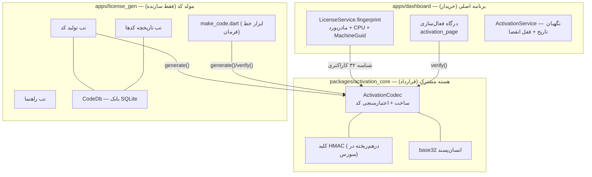
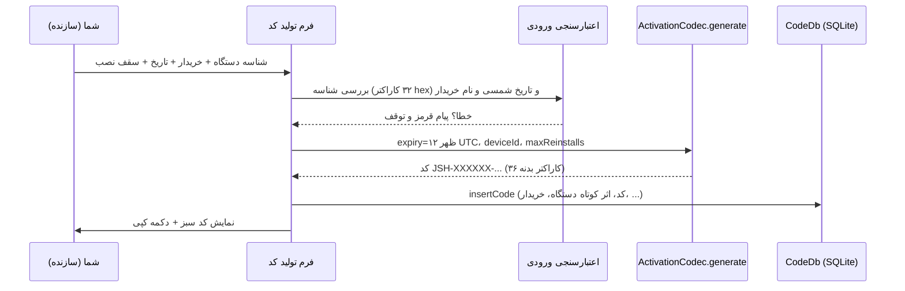

# نقشه برنامه — معماری مولد کد فعال‌سازی J.S.H

این سند نقشه کامل برنامه است: چه فایل‌هایی وجود دارند، هر کدام چه کار می‌کنند، و داده‌ها چطور جاری می‌شوند. با همین سند می‌توانید هر بخش را پیدا و تغییر دهید.

---

## ۱) معماری کلان — هسته مشترک

نکته کلیدی طراحی: موتور ساخت/اعتبارسنجی کد در **یک بسته مشترک** (`packages/activation_core`) است و برنامه اصلی و مولد هر دو از همان استفاده می‌کنند. یعنی همیشه سازگارند و یک تغییر در هسته، هر دو را همزمان تحت تأثیر می‌گذارد.



---

## ۲) نقشه فایل‌ها (هر فایل چه‌کار می‌کند)

```text
apps/license_gen/
├── README.md                       ← شروع سریع + لینک مستندات
├── run_windows.bat                 ← اجرا با یک کلیک (ویندوز)
├── build_windows.bat               ← بیلد exe با یک کلیک (ویندوز)
├── pubspec.yaml                    ← نام/نسخه/وابستگی‌ها
├── lib/
│   └── main.dart                   ← کل رابط برنامه (تک‌فایل، ~۴۸۰ خط)
│       ├── CodeDb (خط ۴۱)          ← بانک SQLite تاریخچه: insert/all/bumpInstalls/exportCsv
│       ├── toFa (خط ۱۱۱)           ← تبدیل ارقام به فارسی
│       ├── shamsi (خط ۱۲۰)         ← میلادی → نمایش شمسی
│       ├── parseShamsi (خط ۱۲۶)    ← ورودی شمسی فارسی → میلادی
│       ├── _validateDevice (۱۷۹)   ← قواعد شناسه دستگاه (۳۲ کاراکتر hex)
│       ├── _generate (۱۹۰)         ← ساخت کد + ثبت در بانک
│       ├── _quickExpiry (۲۳۵)      ← دکمه‌های میان‌بر ۱/۳/۶/۱۲/۲۴ ماه
│       ├── _generateTab (۳۱۰)      ← فرم تولید کد + کپی کد
│       ├── _historyTab (۳۹۰)       ← جدول تاریخچه + خروجی CSV + ثبت نصب
│       └── _helpTab (۴۶۱)          ← راهنمای درون‌برنامه‌ای
├── test/
│   └── license_gen_test.dart       ← تست‌های برنامه مولد
└── windows/, linux/                ← پوسته بومی اجرا (دست‌نخورده)

packages/activation_core/           ← هسته مشترک (مهم‌ترین پوشه)
├── lib/activation_core.dart        ← ActivationCodec: ساخت + اعتبارسنجی + کلید + base32
├── test/activation_core_test.dart  ← ۱۰ تست هسته (رفت‌وبرگشت، دستکاری، دستگاه دیگر، انقضا، ...)
└── example/make_code.dart          ← ابزار خط فرمان تولید/بررسی کد

.github/workflows/build.yml         ← CI: تست هسته + تست مولد + بیلد exe در Release تگ‌ها
```

---

## ۳) جریان داده داخل مولد (وقتی دکمه «تولید کد» را می‌زنید)



---

## ۴) وابستگی‌ها و نقش هرکدام

| بسته | کجا | نقش |
|---|---|---|
| `activation_core` (path: ../../packages/activation_core) | مولد + برنامه اصلی | موتور کد — تک‌منبع حقیقت |
| `sqflite_common_ffi` | مولد | SQLite دسکتاپ (FFI) برای بانک تاریخچه |
| `path_provider` | مولد | پیدا کردن پوشه بانک (AppData) و Documents برای CSV |
| `shamsi_date` | مولد + هسته | تقویم شمسی (ورودی تاریخ اعتبار + نمایش) |
| `crypto` | هسته | SHA-256 و HMAC |
| `path` | مولد | ساخت مسیرها |

---

## ۵) تصمیم‌های طراحی و دلیل آن‌ها

| تصمیم | دلیل |
|---|---|
| تک‌فایل بودن رابط مولد (`main.dart`) | برنامه کوچک است؛ همه‌چیز در یک فایل قابل مرور و تغییر است |
| هسته مشترک به‌جای کپی الگوریتم | کوچک‌ترین خطا در دو پیاده‌سازی جدا = کدهای بی‌اثر؛ هسته واحد این ریسک را حذف می‌کند |
| Flutter برای مولد (نه Python/...) | همان زبان برنامه اصلی؛ یک هسته مشترک واقعی ممکن می‌شود + UI فارسی/RTL راحت |
| SQLite با sqflite_common_ffi | دسکتاپ‌پسند، بدون وابستگی سرور، قابل پشتیبان‌گیری با کپی فایل |
| تاریخ اعتبار روزانه در ساعت ۱۲ ظهر UTC | تغییر منطقه زمانی/ساعت تابستانی خریدار، روز انقضا را جابه‌جا نمی‌کند |
| سقف نصب «۰ = پیش‌فرض برنامه» | سیاست نصب در برنامه اصلی (`AppInfo.maxInstalls`) بدون تغییر کدهای صادرشده قابل تغییر است |

---

## ۶) مرز «مولد» و «برنامه اصلی» — چه چیزی مشترک است؟

| مورد | مالکیت | اگر تغییر دهید |
|---|---|---|
| فرمت کد، کلید امضا، base32 | `activation_core` (مشترک) | باید هر دو برنامه همزمان بازنشر شوند؛ کدهای قبلی ممکن است باطل شوند |
| قواعد شناسه دستگاه | برنامه اصلی (LicenseService) + اعتبارسنجی فرم در مولد | اگر فرمت شناسه در برنامه اصلی عوض شود، اعتبارسنجی مولد را هم به‌روز کنید |
| سقف نصب پیش‌فرض (۳) | برنامه اصلی — `AppInfo.maxInstalls` | مولد نیازی به تغییر ندارد؛ «۰» یعنی همان پیش‌فرض |
| رنگ/متن/دکمه‌های اعتبار | فقط مولد (`main.dart`) | هیچ تأثیری روی برنامه اصلی |
| بانک تاریخچه | فقط مولد | هیچ تأثیری روی برنامه اصلی |

---

## ۷) شمارنده نصب — کجا زندگی می‌کند؟

دو مکانیزم متفاوت وجود دارد و نباید اشتباه گرفته شوند:

1. **سقف نصب پیش‌فرض برنامه (۳ بار) — در حال اجرا اعمال می‌شود:** برنامه اصلی نصب‌ها را در سه محل مستقل می‌شمارد (فایل پنهان `ProgramData\JSH\.license_store`، رجیستری `HKCU\Software\JSH\License`، و رکورد بانک برنامه؛ بیشینه معتبر است) و با `AppInfo.maxInstalls` (پیش‌فرض ۳) مقایسه می‌کند. بار چهارم = قفل با پیام تماس با پشتیبانی. کد: `apps/dashboard/lib/core/services/license_service.dart`.

2. **بایت `maxReinstalls` داخل کد فعال‌سازی — سقف اختصاصی هر کد:** مولد این مقدار را در کد می‌نویسد (۰ = پیش‌فرض برنامه) و `ActivationCodec.verify` آن را در `ActivationResult.maxReinstalls` برمی‌گرداند. در نسخه جاریِ برنامه اصلی، اعمالِ واقعی نصب با شمارنده محلی و پیش‌فرض ۳ است؛ این بایت جای توسعه برای «سقف متفاوت برای هر کد» است — یعنی اگر بعداً بخواهید برای یک خریدار خاص سقف ۱ یا ۵ بگذارید، زیرساختش آماده است.
